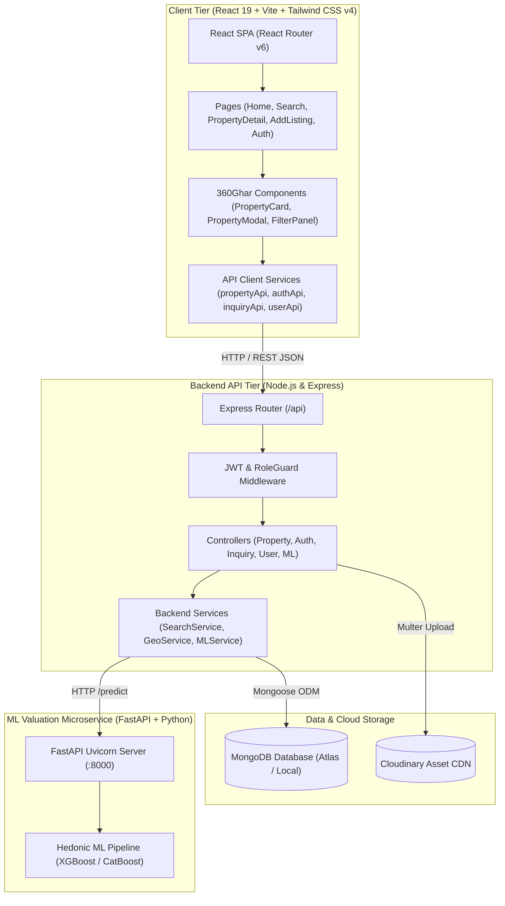
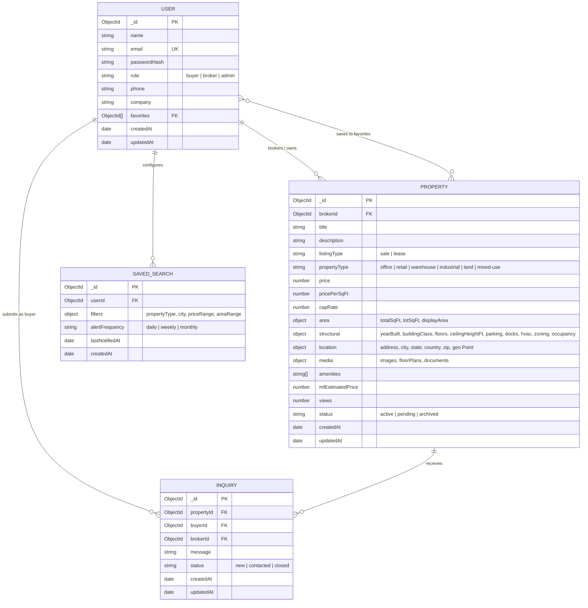
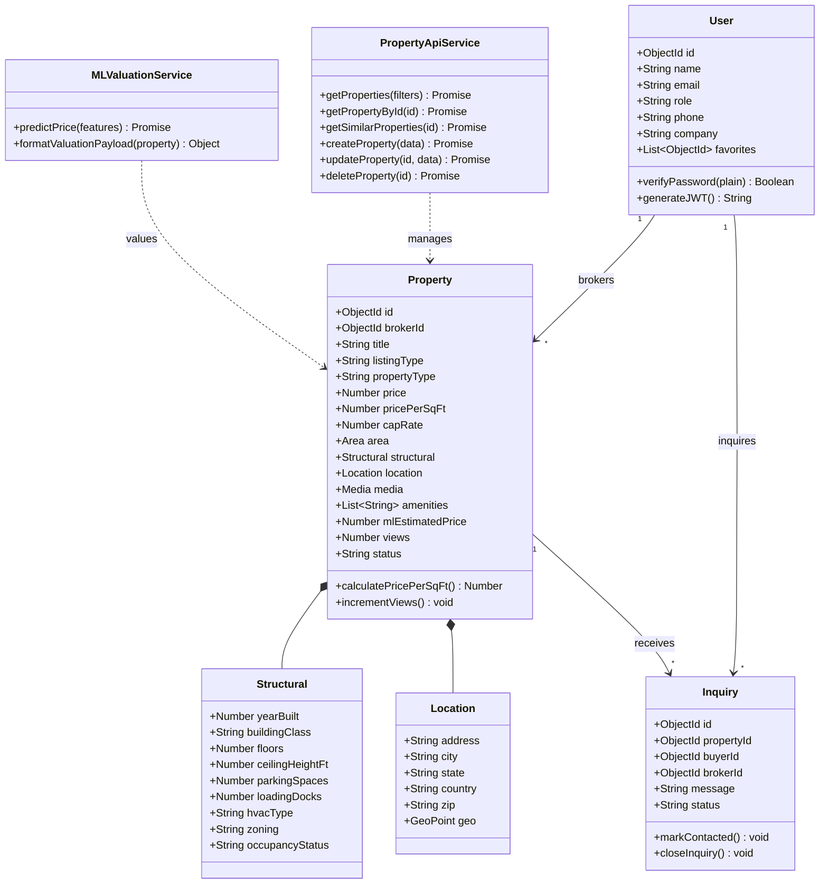
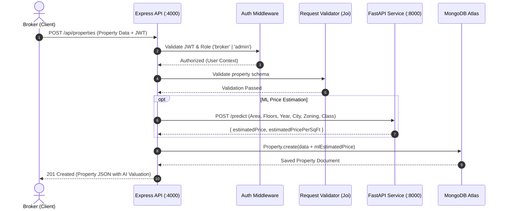
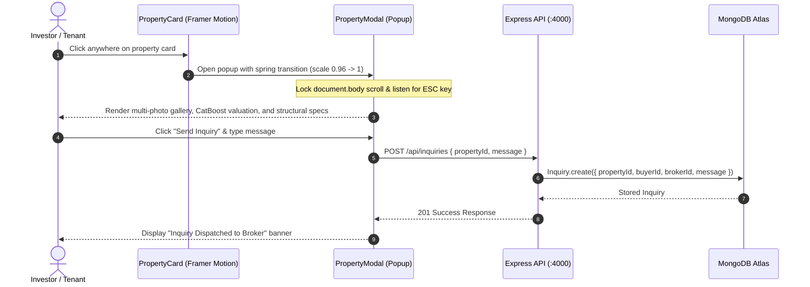
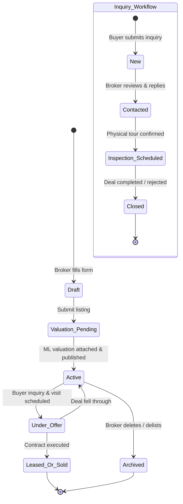

# NoWay — Commercial Real Estate Intelligence Platform

**NoWay** is an institutional-grade commercial real estate marketplace and valuation platform built with a modern MERN stack and a dedicated FastAPI machine-learning microservice. 

The frontend has been redesigned using **360Ghar-AI-Advisor** as an interaction reference, featuring Framer Motion spring-animated property detail modals, responsive multi-photo galleries, dual-currency formatting (₹ INR Lakhs/Crores & $ USD), and an institutional **60-30-10 visual palette** (**Charcoal 60%**, **Sand 30%**, and **Electric Blue 10%**).

---

## Table of Contents

1. [System Architecture & UML Diagrams](#system-architecture--uml-diagrams)
   - [High-Level System Architecture](#1-high-level-system-architecture)
   - [Database Entity-Relationship Diagram (ERD)](#2-database-entity-relationship-diagram-erd)
   - [Domain Model Class Diagram](#3-domain-model-class-diagram)
   - [Sequence Diagram: AI Property Valuation & Creation](#4-sequence-diagram-ai-property-valuation--creation)
   - [Sequence Diagram: 360Ghar Interactive Modal & Inquiry](#5-sequence-diagram-360ghar-interactive-modal--inquiry)
   - [State Diagram: Listing & Inquiry Lifecycle](#6-state-diagram-listing--inquiry-lifecycle)
2. [Design System (60-30-10 Palette)](#design-system-60-30-10-palette)
3. [Key Features](#key-features)
4. [Tech Stack](#tech-stack)
5. [Project Structure](#project-structure)
6. [Datasets (Indian & Global Commercial Assets)](#datasets-indian--global-commercial-assets)
7. [Getting Started](#getting-started)
8. [API Documentation](#api-documentation)
9. [Environment Variables](#environment-variables)

---

## System Architecture & UML Diagrams

### 1. High-Level System Architecture



---

### 2. Database Entity-Relationship Diagram (ERD)



---

### 3. Domain Model Class Diagram



---

### 4. Sequence Diagram: AI Property Valuation & Creation



---

### 5. Sequence Diagram: 360Ghar Interactive Modal & Inquiry



---

### 6. State Diagram: Listing & Inquiry Lifecycle



---

## Design System (60-30-10 Palette)

The platform adheres strictly to the **60-30-10 interior & architectural color distribution**:

| Color Role | Proportion | Color Code | Application |
|---|---|---|---|
| **Charcoal** | **60%** (Dominant) | `#12151a` / `#171c22` | Dark sticky navbar, institutional footer, hero contrast backdrop, primary typography, dark card headers, and modal frame. |
| **Sand** | **30%** (Secondary) | `#faf7f2` / `#f4ede1` | Clean architectural body canvas (`#faf7f2`), warm section surfaces (`#f4ede1`), soft borders (`#e6ded2`), filter panels, and spec grids. |
| **Electric Blue** | **10%** (Accent) | `#0066ff` / `#0052cc` | High-impact action buttons (*"Search Spaces"*, *"Schedule Tour"*, *"Send Inquiry"*), transaction badges (*"For Lease"*), verified ML badges, active pills, and glows. |

---

## Key Features

### Frontend (React 19 + Vite + Tailwind CSS v4)
- **360Ghar-Inspired Interactive Property Cards**: Click-anywhere card surface with subtle hover elevation (`hover:-translate-y-1.5`), image zoom (`scale-105`), and independent wishlist toggle.
- **Large Property Detail Modal**: Built with Framer Motion `AnimatePresence`, spring entrance, image carousel with counter (`1 / 4`), fullscreen zoom, structural specs, AI valuation insight, and inline inquiry/tour drawers.
- **Dedicated Indian Commercial Catalog**: Indian Rupee (`₹` Lakhs/Crores) formatting, plot dimensions, FAR, zoning designations, and road frontage.
- **Advanced Commercial Search Engine**: Sidebar filter panel + responsive mobile slide-in drawer, sorting, pagination, and dual grid/list view toggle.
- **Standalone Property Route (`/property/:id`)**: Comprehensive asset page with multi-thumbnail gallery, structural tables, and similar property recommendations.

### Backend API (Express + MongoDB)
- **JWT & Role-Based Access Control**: Secure registration, login, refresh tokens, and broker/admin authorization guards.
- **Geospatial & Filter Search**: Filter by property type, price, area, building class, and `2dsphere` geospatial nearby queries.
- **Broker Lead Management**: Direct inquiry pipeline routing buyer messages to listing brokers.
- **Automated ML Valuation Integration**: Automatic hedonic valuation on property creation and update.

### Machine-Learning Microservice (FastAPI + XGBoost)
- **FastAPI Endpoints**: `/health` and `/predict`.
- **Regression Pipeline**: Estimates fair total price and price per square foot based on property type, area, floor count, year built, and micro-market location.

---

## Tech Stack

| Layer | Technologies |
|---|---|
| **Frontend** | React 19, Vite 8, Tailwind CSS v4, Framer Motion, Lucide React, Axios, React Router v6 |
| **Backend API** | Node.js, Express, MongoDB (Mongoose), Joi, JSON Web Tokens, bcrypt, Multer, Cloudinary, Axios |
| **ML Microservice** | Python 3, FastAPI, Uvicorn, XGBoost, Scikit-Learn, Pandas, NumPy, Joblib |

---

## Project Structure

```text
NoWay/
├── client/
│   ├── package.json
│   ├── vite.config.js
│   ├── src/
│   │   ├── App.jsx                        # Master layout wrapper with Charcoal & Sand canvas
│   │   ├── index.css                      # Tailwind v4 theme, 60-30-10 design tokens & scrollbars
│   │   ├── components/
│   │   │   ├── common/
│   │   │   │   ├── Navbar.jsx             # Charcoal header with Electric Blue active pills
│   │   │   │   ├── Footer.jsx             # Institutional dark footer with quick links
│   │   │   │   └── Logo.jsx               # Brand identity
│   │   │   ├── property/
│   │   │   │   ├── PropertyCard.jsx       # 360Ghar interactive card with Framer Motion
│   │   │   │   ├── PropertyModal.jsx      # Spring-animated detail popup with AI comps & inquiry
│   │   │   │   ├── PropertyGrid.jsx       # Responsive grid with viewMode toggle
│   │   │   │   ├── PropertyGallery.jsx    # Multi-thumbnail carousel & lightbox
│   │   │   │   ├── PropertySpecifications.jsx # Structural & land metrics table
│   │   │   │   └── SimilarProperties.jsx  # Related listings carousel
│   │   │   ├── filters/
│   │   │   │   ├── FilterPanel.jsx        # Desktop filter sidebar
│   │   │   │   └── MobileFilterDrawer.jsx # Slide-in mobile filter drawer
│   │   │   └── sections/
│   │   │       ├── HeroSection.jsx        # "Find the Right Space. Build What's Next."
│   │   │       ├── CategorySection.jsx    # Commercial typology explorer
│   │   │       ├── FeaturedProperties.jsx # Featured & recent tabbed listings
│   │   │       ├── LocationSection.jsx    # Top Indian & global hubs
│   │   │       ├── HowItWorks.jsx         # 4-step institutional workflow
│   │   │       └── CTASection.jsx         # Broker listing banner
│   │   ├── data/
│   │   │   ├── mockProperties.js          # Unified commercial dataset (Indian + US)
│   │   │   ├── indianCommercialLandProperties.js # 10 Indian commercial & land parcels (₹ Lakhs/Cr)
│   │   │   ├── reference360GharProperties.js    # 12 original Gurgaon reference listings
│   │   │   └── filterConstants.js         # Cities, categories, and ratings
│   │   ├── pages/
│   │   │   ├── Home.jsx                   # Modernized landing experience
│   │   │   ├── Search.jsx                 # Search & filtering page
│   │   │   ├── PropertyDetail.jsx         # Standalone /property/:id route
│   │   │   ├── AddEditListing.jsx         # 4-step broker listing studio
│   │   │   └── Auth.jsx                   # Broker sign-in & registration
│   │   └── services/
│   │       ├── axiosClient.js             # Base Axios instance with auth interceptor
│   │       ├── propertyApi.js             # Property queries with graceful fallback
│   │       ├── authApi.js                 # Authentication service
│   │       ├── inquiryApi.js              # Broker inquiry service
│   │       └── userApi.js                 # Favorites & profile service
├── server/
│   ├── package.json
│   └── src/
│       ├── app.js                         # Express application setup
│       ├── server.js                      # Server entry point (:4000)
│       ├── controllers/                   # Property, Auth, Inquiry, User, ML controllers
│       ├── models/                        # Mongoose models (Property, User, Inquiry, SavedSearch)
│       ├── routes/                        # Express API routes
│       └── services/                      # Search, Geo, and ML integration services
└── ml-service/
    ├── app.py                             # FastAPI prediction endpoints (:8000)
    ├── model.py                           # Valuation model definition
    ├── train.py                           # Model training script
    └── requirements.txt                   # Python dependencies
```

---

## Datasets (Indian & Global Commercial Assets)

The platform features dedicated, legally-curated demo listings structured for commercial real estate:

1. **Indian Commercial & Land Inventory (`indianCommercialLandProperties.js`)**:
   - **Gurgaon (CyberCity / Golf Course Ext)**: Grade-A IT campuses and commercial plots.
   - **Bengaluru (Outer Ring Road / Whitefield)**: GCC tech parks and commercial development land.
   - **Mumbai (Bandra Kurla Complex - BKC)**: Premier financial headquarters and commercial offices.
   - **Hyderabad (HITEC City / Financial District)**: High-density commercial floors.
   - **Mohali & Chandigarh (IT City / Industrial Area)**: Warehouses, manufacturing plants, and industrial land.
   - **Noida, Pune, Jaipur, and Delhi**: Logistics parks and enterprise retail.
2. **US Commercial Listings**:
   - Class-A assets in Seattle, Austin, Denver, Chicago, Miami, and Atlanta.
3. **Reference 360Ghar Listings (`reference360GharProperties.js`)**:
   - Preserves all 12 original Gurgaon residential reference properties verbatim for demo reference.

---

## Getting Started

### Prerequisites
- **Node.js**: v18 or later
- **Python**: v3.10 or later
- **MongoDB**: Local MongoDB instance or MongoDB Atlas URI

### 1. Start the Frontend
```powershell
cd client
npm install
npm run dev
```
The client starts on `http://localhost:5173`.

### 2. Start the Backend API
```powershell
cd server
npm install
npm run dev
```
The Express server starts on `http://localhost:4000`.

### 3. Start the ML Service
```powershell
cd ml-service
python -m pip install -r requirements.txt
python train.py
python -m uvicorn app:app --host 127.0.0.1 --port 8000 --reload
```
The FastAPI microservice starts on `http://localhost:8000`.

---

## API Documentation

All backend endpoints are prefixed with `/api`.

| Module | Method | Path | Description | Access |
|---|---|---|---|---|
| **Auth** | `POST` | `/api/auth/register` | Register a new buyer or broker | Public |
| **Auth** | `POST` | `/api/auth/login` | Authenticate and obtain JWT tokens | Public |
| **Auth** | `POST` | `/api/auth/refresh` | Refresh an expired access token | Public |
| **Properties** | `GET` | `/api/properties` | Search listings with filters & pagination | Public |
| **Properties** | `GET` | `/api/properties/:id` | Fetch property details by ID (increments views) | Public |
| **Properties** | `GET` | `/api/properties/:id/similar` | Fetch similar commercial spaces | Public |
| **Properties** | `GET` | `/api/properties/nearby` | Geospatial search (`lat`, `lng`, `radiusKm`) | Public |
| **Properties** | `POST` | `/api/properties` | Create a commercial listing + auto ML estimate | Broker / Admin |
| **Properties** | `PUT` | `/api/properties/:id` | Update an existing listing | Broker / Admin |
| **Properties** | `DELETE` | `/api/properties/:id` | Delete listing | Broker / Admin |
| **Inquiries** | `POST` | `/api/inquiries` | Send an inquiry about a property | Authenticated |
| **Inquiries** | `GET` | `/api/inquiries/broker` | View inquiries for broker's listings | Broker / Admin |
| **Users** | `GET` | `/api/users/me/favorites` | Retrieve user's saved properties | Authenticated |
| **Users** | `POST` | `/api/users/me/favorites/:propertyId` | Save property to favorites | Authenticated |
| **Users** | `DELETE` | `/api/users/me/favorites/:propertyId` | Remove property from favorites | Authenticated |
| **ML Service** | `POST` | `/api/ml/predict` | Direct valuation prediction | Public |

---

## Environment Variables

Create `server/.env` with your local or deployment secrets:

```dotenv
PORT=4000
MONGO_URI=mongodb://localhost:27017/noway
JWT_SECRET=your_jwt_secret_key_here
JWT_REFRESH_SECRET=your_jwt_refresh_secret_key_here
ML_SERVICE_URL=http://localhost:8000
CLOUDINARY_CLOUD_NAME=your_cloud_name
CLOUDINARY_API_KEY=your_api_key
CLOUDINARY_API_SECRET=your_api_secret
VITE_API_URL=http://localhost:4000/api
```

---

## Quality Assurance & Verification

- **Linting**: Run `npm run lint` inside `client/` to verify ESLint compliance. (Currently passing with **0 errors and 0 warnings**).
- **Production Build**: Run `npm run build` inside `client/` to verify Vite bundle optimization and chunking.
- **Rule Compliance**: Plain JavaScript JSX only (no TypeScript), functional components with hooks, pure MERN architecture intact.
